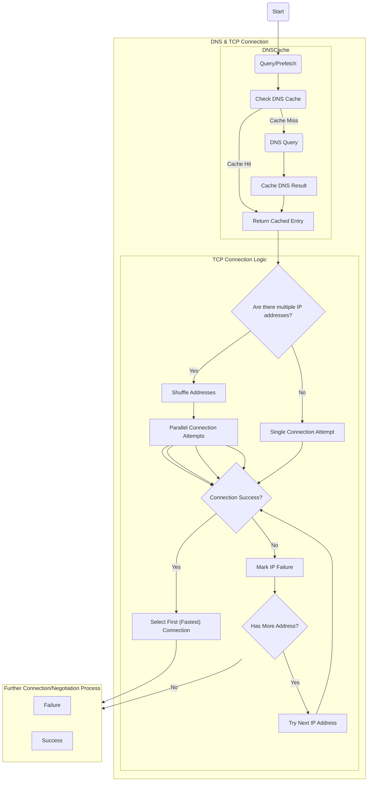

# Connection Improvements

As described in the [DNS topic](../DNS/dns-cache.md), DNS queries can be prefetched and cached on startup, long before the first user interaction, so the first request does not have to wait for name resolution.

There is also a new TCP connection step after the DNS query.
The old logic walked the IP addresses from the DNS result one by one. If the first address was slow and used up the request's connect time, the whole request timed out, even though another address could have connected quickly.

To resolve this issue, and even improve on the connection speed in v3, if there are multiple addresses it will try to connect to a maximum of 4 (by default, it's configurable) at once and pick the fastest connecting one!
Those addresses that fail to connect are marked as such, and if there's a need for a new connection, those IP addresses will be tried last.

Another new feature is that custom IP address shuffling algorithms can be added and implemented.

!!! Note "These improvements are used automatically and improve the connection speed of all protocols that are using Best HTTP. So, for example both Best Socket.IO and Best SignalR, after the initial negotiation request will try to connect with their WebSocket transport, but now WebSocket does NOT have to wait for a DNS query because the IP addresses are already cached!"

## High-Level Flow

Here's a high-level view about the algorithm:


## Sockets that lose the race

The first socket that connects is the one the request uses. The other attempts are not discarded when they connect later.

A socket that finishes connecting after a winner has already been chosen is kept in a shared cache, keyed by host name and port. The next connection to that same host and port takes the cached socket and skips a new race, as long as the socket is still connected. Sockets that fail to connect are still reported as non-working and are not cached. A cached socket that has already closed is dropped, and the lookup continues with the next entry.

Cached sockets expire. The defaults are **20 seconds** (`UnusedSocketCacheDuration`) and **256 sockets** (`MaxCachedSockets`). Either limit turns the cache off when it is set to zero or a negative value. A full cache, or the application quitting, closes the late socket instead of storing it.

Both values come from the host's `TCPRingmasterSettings` at the moment the race starts:

```cs title="Keep a losing socket for one minute"
Best.HTTP.Shared.HTTPManager.PerHostSettings.Get("example.com")
    .TCPRingmasterSettings.UnusedSocketCacheDuration = TimeSpan.FromMinutes(1);
```

```cs title="Disable reuse of sockets that lost the race"
var settings = Best.HTTP.Shared.HTTPManager.PerHostSettings.Get("*");
settings.TCPRingmasterSettings.UnusedSocketCacheDuration = TimeSpan.Zero;
```

`UnusedSocketCacheDuration = TimeSpan.Zero` and `MaxCachedSockets = 0` both disable the cache.

## Code Examples

```cs title="Disable Shuffling of Addresses For One Host"
Best.HTTP.Shared.HTTPManager.PerHostSettings.Get("example.com")
                .TCPRingmasterSettings.ShuffleAddresses = false;
```

```cs title="Disable Shuffling of Addresses For Every Host"
Best.HTTP.Shared.HTTPManager.PerHostSettings.Get("*")
                .TCPRingmasterSettings.ShuffleAddresses = false;
```

More about how to use `PerHostSettings` can be found under the [Per-Host Settings](per-host-settings.md) topic.

```cs title="Implement a custom shuffling algorithm for one host"
Best.HTTP.Shared.HTTPManager.PerHostSettings.Get("example.com")
                .TCPRingmasterSettings.CustomAddressShuffleAlgorithm 
                    = (@params) =>
                    {
                        var rand = new System.Random();
                        int n = @params.Addresses.Length;
                        while (n > 1)
                        {
                            int k = rand.Next(n--);
                            (@params.Addresses[n], @params.Addresses[k]) = (@params.Addresses[k], @params.Addresses[n]);
                        }
                    };
```

```cs title="Revert Back To The Old Behavior For a Specific Host"
var settings = Best.HTTP.Shared.HTTPManager.PerHostSettings.Get("example.com");
            settings.TCPRingmasterSettings.MaxSimultaneousRacers = 1;
            settings.TCPRingmasterSettings.ShuffleAddresses = false;
```